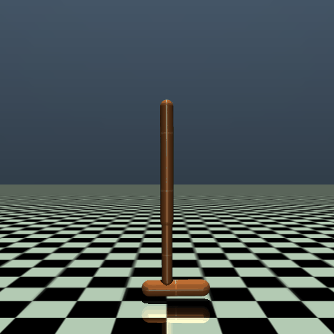
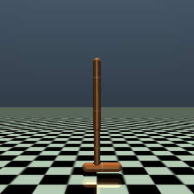
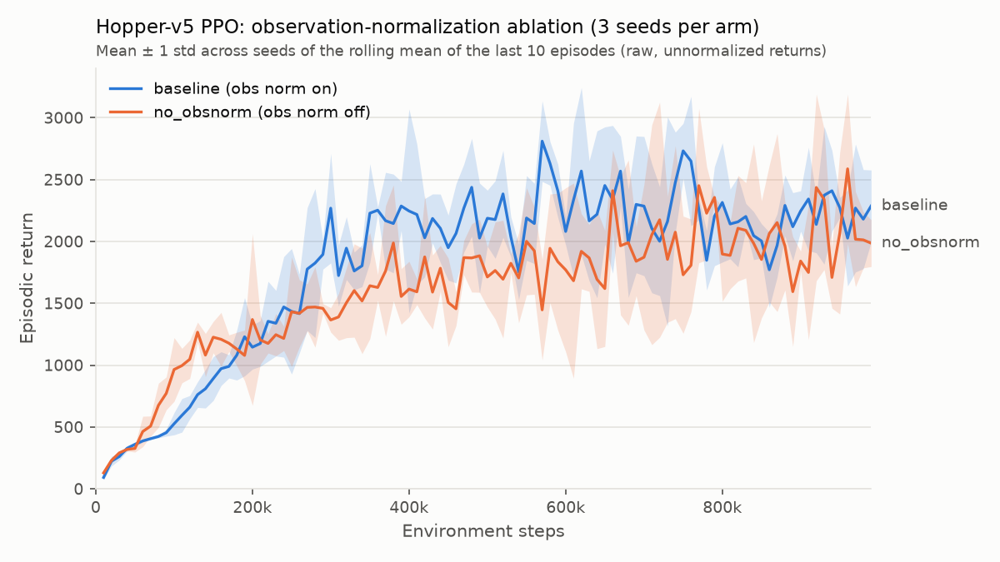

# PPO Locomotion → Edge Deployment

Implemented PPO from scratch in PyTorch, trained a MuJoCo Hopper robot to hop, ran a seeded ablation
study, and deployed the policy as a self-contained ONNX model (FP32, plus an INT8-quantized variant)
benchmarked against a real-time control budget.

No RL library: the actor-critic, GAE and the PPO update are written out in [`ppo/`](ppo/). Everything
runs on a CPU (results below are from an Apple M1 laptop).

## Demo

| Random actions | Trained PPO policy (deterministic, 1,000 steps, return 3567) |
|---|---|
|  |  |

## Results

### Training: observation-normalization ablation



Hopper-v5, 999,424 environment steps per run, 3 seeds per arm, everything identical except `obs_norm`.

| Arm | obs norm | Training return, last 10 episodes ([summary.md](results/summary.md)) | Deterministic eval, 10 episodes per seed | Eval per seed (1 / 2 / 3) |
|---|---|---|---|---|
| baseline | on | **2132.9 ± 123.0** | 3041.5 ± 670.2 | 3272.1 / 2286.4 / 3566.0 |
| no_obsnorm | off | 1912.0 ± 92.9 (−10.4%) | **3571.5 ± 79.1** (+17.4%) | 3547.6 / 3507.1 / 3659.8 |

Mean ± sample std across the 3 seeds. Training returns come from the stochastic policy during training;
evaluation uses mean actions on a plain env (true returns) with seeds 1000–1009. The 6 runs trained
in parallel in about 15 minutes (≈1,130–1,230 steps/s each; a single run alone does ≈2,150 steps/s).

### Deployment: batch-1 latency ([benchmark.md](results/benchmark.md))

Policy `models/best.pt` (baseline seed 3). One thread everywhere, 200 warm-up + 10,000 timed calls on
real observations, Apple M1, macOS 14.8.

| Variant | p50 (µs) | p95 (µs) | p99 (µs) | inferences/s | size (KB) | eval return (10 ep) | max abs action diff vs PyTorch | p99 % of 8 ms |
|---|---|---|---|---|---|---|---|---|
| PyTorch FP32 (eager) | 25.2 | 25.5 | 25.9 | 39,546 | 23.5 | 3566.0 ± 7.7 | 0 | 0.32% |
| ONNX Runtime FP32 | **6.6** | 6.8 | **6.9** | 150,998 | 22.1 | **3566.5 ± 8.3** | 6.3e-07 | **0.09%** |
| ONNX Runtime INT8 | 9.0 | 9.2 | 9.3 | 110,307 | **9.3** | 3494.9 ± 182.2 | 1.4e-01 | 0.12% |

- **ONNX Runtime FP32 is the deployment pick:** 3.8× faster than eager PyTorch at p50, identical return,
  and its p99 uses 0.09% of Hopper's 8 ms control period.
- **INT8 made things worse here.** It is 58% smaller but 36% *slower* than FP32 (quantizing activations
  at every call costs more than the integer matmuls save on a 5k-parameter MLP), its actions differ by up
  to 0.14, and it fell in 1 of 10 evaluation episodes (step 803, return 2968; the other 9 averaged 3554).

### Fixed-rate control loop ([control_loop.md](results/control_loop.md))

The INT8 ONNX policy driving Hopper at its real control rate, 125 Hz (8 ms period), for 10 s: each tick
reads the observation, runs inference and steps the simulator, then waits for the next absolute deadline.

| Timing (µs) | p50 | p99 | max |
|---|---|---|---|
| inference | 95.8 | 187.4 | 251.2 |
| work per tick (obs → infer → env.step) | 556.4 | 781.0 | 1323.9 |
| tick-start lateness | 0.1 | 0.2 | 19.7 |

**0 / 1,250 deadline misses**, jitter (std of tick-start error) **0.6 µs**, worst tick 16.6% of the
period. Inference inside the loop is ~10× slower than in the hot benchmark loop (95.8 vs 9.0 µs at p50):
between ticks the sleep and the physics step evict ONNX Runtime's code and data from the CPU caches and
let the core clock down. The benchmark is the best case; the loop is what a controller actually sees.
(The INT8 policy fell once during this run, at step 564; the FP32 model completes that episode.)

## What's implemented

- **PPO from scratch** ([`ppo/train.py`](ppo/train.py)): clipped surrogate objective, clipped value
  loss, per-minibatch advantage normalization, linear LR annealing, global gradient-norm clipping, Adam
  with eps 1e-5, optional target-KL early stop, and approx-KL / clip-fraction / explained-variance
  diagnostics.
- **GAE** ([`ppo/gae.py`](ppo/gae.py)) with a hand-computed unit test across an episode boundary.
- **Actor-critic** ([`ppo/agent.py`](ppo/agent.py)): separate 64-64 tanh MLPs, orthogonal init, 0.01-gain
  output layer, state-independent log-std; 5,126 actor parameters.
- **Observation normalizer as an `nn.Module`** ([`ppo/normalizer.py`](ppo/normalizer.py)): running
  mean/variance buffers with the parallel (Chan et al.) update, checked against Gymnasium's
  `RunningMeanStd`.
- **Experiment tooling**: YAML + CLI config dataclass, seeded and repeatable runs (the same seed gives
  identical logs), per-run CSV logs with optional W&B (`--track`), and a cross-platform launcher for the
  6-run ablation ([`scripts/run_experiments.py`](scripts/run_experiments.py)).
- **Deployment**: ONNX export with a parity check, INT8 dynamic quantization, a single-thread batch-1
  latency benchmark, a fixed-rate control-loop demo and a GIF recorder (all in [`scripts/`](scripts/)).

## Ablation

**What:** observation normalization inside the model, on vs off, with everything else identical (reward
normalization stays on in both arms), 3 seeds × 1M steps. **What happened:** with normalization the
final *training* returns were 10.4% higher (2133 ± 123 vs 1912 ± 93), but deterministic *evaluation* of
the final policies reversed the order (3042 ± 670 vs 3572 ± 79), largely because baseline seed 2 still
falls in some episodes (mean length 667 of 1000). **Why:** Hopper's 11 features already sit in a modest
range (learned std 0.04–5.6), so raw inputs are unlikely to saturate the tanh layers, and the
no-normalization runs ended with more exploration noise (mean policy entropy 2.29 vs 1.56), which lowers
stochastic training returns but not mean-action evaluation. At 3 seeds, observation normalization gave
no clear benefit on Hopper; I am reporting that as the finding rather than tuning until it looks right.

## Deployment pipeline

```
models/best.pt ─▶ DeployPolicy ─▶ policy_fp32.onnx ─▶ parity test ─▶ policy_int8.onnx ─▶ benchmark ─▶ control loop
                  frozen normalizer   opset 17, 22.1 KB  6.3e-07 max     9.3 KB, dynamic     batch 1,     125 Hz, 0 misses
                  → actor mean        dynamic batch,     abs diff on     INT8 weights        1 thread
                  → clamp [-1, 1]     one file           2,000 real obs
```

1. **Checkpoint → `DeployPolicy`** ([`scripts/export_onnx.py`](scripts/export_onnx.py)): only what runs
   on the robot (the frozen normalizer, the actor mean and a clamp to the actuator limits). The critic and
   log-std are left out. Input is the raw observation.
2. **ONNX FP32**: `torch.onnx.export` at opset 17 with a dynamic batch axis. The graph is just
   `Sub → Div → Clip → (Gemm → Tanh) ×2 → Gemm → Clip` (normalize, clip to ±10, MLP, clamp actions),
   with the normalizer statistics as constants.
3. **Parity test**: PyTorch vs ONNX Runtime on 2,000 real observations, max abs difference 6.3e-07
   (tolerance 1e-5). [`tests/test_export_parity.py`](tests/test_export_parity.py) repeats this for an
   untrained policy with non-trivial normalizer statistics in about 3 s.
4. **INT8** ([`scripts/quantize.py`](scripts/quantize.py)): ONNX Runtime dynamic quantization (INT8
   weights; activations quantized per call with `DynamicQuantizeLinear` → `MatMulInteger`).
5. **Benchmark** ([`scripts/benchmark.py`](scripts/benchmark.py)) and **control loop**
   ([`scripts/control_loop_demo.py`](scripts/control_loop_demo.py)), results above.

## Reproduce

```bash
python3.11 -m venv .venv && source .venv/bin/activate   # Windows: .venv\Scripts\activate
pip install -r requirements.txt
python -m pytest                                          # GAE + export parity tests

# Optional 20k-step smoke test (delete its runs/ folder afterwards so the plot only sees the 6 runs)
python -m ppo.train --config configs/hopper_baseline.yaml --seed 1 --total_timesteps 20000

python -m scripts.run_experiments                         # 6 runs: {baseline, no_obsnorm} x seeds {1,2,3}
python -m scripts.plot_results                            # results/learning_curves.png, results/summary.md
python -m scripts.evaluate --checkpoint runs/Hopper-v5__baseline__seed*/checkpoints/final.pt --save_best models/best.pt
python -m scripts.evaluate --checkpoint runs/Hopper-v5__no_obsnorm__seed*/checkpoints/final.pt
python -m scripts.export_onnx                             # models/policy_fp32.onnx + parity check
python -m scripts.quantize                                # models/policy_int8.onnx
python -m scripts.benchmark                               # results/benchmark.md, results/benchmark.csv
python -m scripts.control_loop_demo                       # results/control_loop.md
python -m scripts.record_gif && python -m scripts.record_gif --random   # assets/*.gif
```

Scripts run as modules (`python -m ...`) from the repo root so they can import `ppo`. Add `--track` to
the training or launcher commands to log to Weights & Biases (after `wandb login`). The runs above used
CSV logging only. On headless Linux, set `MUJOCO_GL=egl` before recording GIFs.

## Design decisions

- **Normalization inside the model.** The running mean/variance are `nn.Module` buffers, so they are
  saved with the weights and baked into the ONNX graph. The robot sends raw sensor readings, and there is
  no separate preprocessing code that could drift from training (train/serve skew).
- **Each observation is normalized once, when it arrives.** The rollout buffer stores the normalized
  observation. Re-normalizing stored observations at update time would use statistics that have since
  moved, so the PPO probability ratio would not start at 1.
- **Same-step autoreset.** On a done step the vector env already returns the next episode's first
  observation, which matches the GAE convention (`dones[t] = 1` marks the first observation of a new
  episode). Gymnasium's default (next-step) would insert an extra reset transition.
- **Single-threaded, batch-1 benchmarking.** One control step is one observation, and one thread mimics
  a single small embedded core while keeping timings stable. The control loop waits on absolute
  `perf_counter` deadlines (sleep, then spin for the last 3 ms) so timing errors cannot accumulate.
- **CleanRL hyperparameters, untuned.** The aim is a correct implementation and a clean ablation, not a
  leaderboard score.
- **Version-specific details** (Python 3.11, PyTorch 2.14, Gymnasium 1.4, ONNX Runtime 1.31):
  - Exported with the torch.export-based exporter, `external_data=False` so the model is one file. It
    builds at opset 18 and converts down to 17.
  - `quant_pre_process` runs before quantization. In dynamic mode ONNX Runtime rewrites each `Gemm` as
    `MatMul` + `Add`, and without pre-processing that rewrite clashes with the exporter's recorded shapes.
  - Checkpoints store the config as a plain dict, so they load under `torch.load`'s `weights_only` default.
  - GIFs use Hopper's own `track` camera. The default camera stays fixed and the robot hops out of view.

## Known limitations

- **Truncation is treated as termination**, so the time-limit step (step 1000) is not bootstrapped with
  V(s). This is a known simplification inherited from the reference implementation.
- **3 seeds and 10 evaluation episodes.** The ablation is underpowered, and Hopper's start states differ
  only by small noise. `models/best.pt` was chosen on the same evaluation seeds it is reported on, so its
  return is optimistic relative to its arm.
- **The CPU benchmark is not real edge hardware.** Apple M1 laptop, general-purpose OS, no real-time
  kernel; the simulator step stands in for sensor and actuator I/O.
- **INT8 gains are limited for tiny MLPs.** Here INT8 was slower than FP32 and less robust, as shown above.

## Next steps

- SAC comparison (off-policy, far more sample-efficient, closer to what real-robot data allows).
- Massively parallel simulation with MJX or Brax.
- Domain randomization (masses, friction, sensor noise, latency) as a step towards sim-to-real.
- TensorRT on a Jetson Orin, where INT8 has hardware support; per-channel or static (calibrated) INT8 to
  reduce the quantization error seen here.
- A custom task with its own reward design or curriculum.
- Bootstrap truncated episodes with V(s) instead of treating them as terminal.

## References

- CleanRL, `ppo_continuous_action.py`: https://github.com/vwxyzjn/cleanrl (the reference implementation)
- Huang et al., "The 37 Implementation Details of Proximal Policy Optimization", ICLR Blog Track 2022:
  https://iclr-blog-track.github.io/2022/03/25/ppo-implementation-details
- Schulman et al., "Proximal Policy Optimization Algorithms", 2017: https://arxiv.org/abs/1707.06347
- Schulman et al., "High-Dimensional Continuous Control Using Generalized Advantage Estimation", 2016:
  https://arxiv.org/abs/1506.02438
- Gymnasium MuJoCo Hopper: https://gymnasium.farama.org/environments/mujoco/hopper
- ONNX Runtime quantization: https://onnxruntime.ai/docs/performance/model-optimizations/quantization.html
